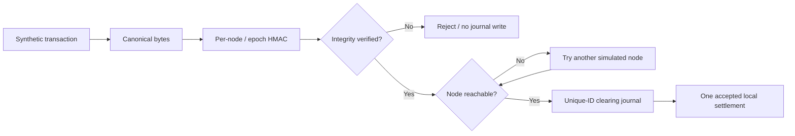

# QRCN — Quantum-Resilient Clearing Network (research miniature)

> **Distributed transaction integrity, simulated moving-target defense, and bounded failover. Not a quantum clearinghouse, bank, cryptocurrency, or payment processor.**

## Start here

This is a self-contained project in the [Renteria AI Systems Portfolio](../../START_HERE.md).
- [Interactive browser demo](../../hosted_demo/qrcn/index.html) (synthetic outcomes, no security guarantees)
- [Core Python implementation](qrcn/core.py)
- [Automated tests](tests/test_core.py) and [Phase 2 durability tests](tests/test_durable.py)
- [Phase 2 executed validation and preserved failures](docs/PHASE2_VALIDATION_2026-11-02.md)
- [Threat model and security limits](docs/THREAT_MODEL.md)
- [Evidence and outstanding gates](docs/VALIDATION.md)

## Purpose

Explore the tradeoffs among message integrity, simulated key rotation, replay rejection, a single-process clearing journal and failover. A researcher can inject a tampered payload, stale authentication tag, node outage or lost acknowledgment and observe whether the local toy ledger accepts, rejects or reroutes the transaction.

## Architecture


## Run

Requires Python 3.11+ (standard library only).

```bash
cd portfolio_projects/qrcn
python -m unittest discover -s tests -v
python -m scripts.run_demo
python -m scripts.run_phase2
```

## Phase 2: file-backed reliability experiment

The optional, standard-library [SQLite adapter](qrcn/durable.py) adds atomic unique-ID commits, per-journal writer fencing, process-restart recovery, multi-threaded duplicate rejection, and read-only detection of conflicting entries when independent partitions both commit. The original Phase 1 core and browser demonstration are retained. [Executed test results, known defects and open gates](docs/PHASE2_VALIDATION_2026-11-02.md) include **23 green unit tests per Python version** and a documented initial SQLite locking failure. The split-brain hazard is **detected but not prevented**.

## Phase 3 — quorum admission and optional PQC evaluation

- [Quorum admission simulator](qrcn/quorum.py) — an **availability gate** requiring a majority of configured simulated members before writing to the Phase 2 shared SQLite journal. It has no independent-node votes or replicated consensus log; it **cannot** resolve real split-brain finality.
- [Phase 3 scenario runner](scripts/run_phase3.py): `python -m scripts.run_phase3`
- [Optional ML-KEM / ML-DSA experiment](scripts/run_pqc.py): `python -m pip install -r requirements-pqc-experiment.txt` then `python -m scripts.run_pqc`. This tests the external `pqcrypto==1.0.0` library locally; it is **not connected** to transport or clearing.
- [Executed Phase 3 report and unresolved failures](docs/PHASE3_VALIDATION_2026-11-02.md), [quorum results](artifacts/phase3_quorum_results_2026-11-02.json), [PQC results](artifacts/phase3_pqc_results_2026-11-02.json).

**The Phase 1 and Phase 2 implementations, demos, test cases and evidence remain intact. Independent security validation and production gates are still OPEN.**

## Phase 4 — Independent acceptors and single-decree Paxos prototype

The [Phase 4 prototype](qrcn/paxos.py) implements **separate file-backed acceptors** with persisted promises and accepted values; the test proposer exchanges prepare and accept messages and requires a majority for a chosen synthetic transaction value. Unlike Phase 3, each node has its **own** SQLite database. An optional [loopback-only TCP server](qrcn/tcpnode.py) lets three independent processes exchange the protocol messages. [Phase 4 validation and limitations](docs/PHASE4_VALIDATION_2026-11-02.md).

```bash
cd portfolio_projects/qrcn
python -m unittest discover -s tests -v
python -m scripts.run_phase4
```

**Not a complete replicated consensus/payment platform:** No total-order log, authenticated peer networking, dynamic leadership, Byzantine consensus, independent security audit, production payments, or integrated post-quantum transport. The Phase 3 ML-KEM/ML-DSA experiments remain separate. The existing public browser demo stays an educational visualization, not a live backend.

## Defined security boundary

- Key derivation is demonstrated using per-node HMAC-SHA256 tags and a monotonically increasing local key epoch. **No post-quantum algorithm or actual key distribution is implemented.**
- Integrity checks cannot provide confidentiality. The simulated payload is visible to the app and browser demo.
- The original Phase 1 journal is an in-memory Python dictionary. The optional Phase 2 [SQLite journal](qrcn/durable.py) persists on a **single local host** across restarts but does **not** implement distributed consensus, guaranteed power-loss durability, multi-party settlement or double-entry accounting.
- Failover simulates selection of a second node after an outage. It is not a realistic distributed recovery guarantee.
- No real payments, financial accounts, network packets, quantum entanglement, QKD, FIPS-certified security or production API integration.
- The browser UI depicts **synthetic, predefined educational cases** rather than interacting with the Python security implementation.

## Project gates

Development: working Python logic, automated tests, reproducible scenario outputs, demonstrable intentional failures.
Independent validation: **OPEN** — requires third-party threat review and held-out perturbations.
Production: **OPEN** — Phase 2 provides an experimental single-host journal; genuine multi-node consensus/finality, power-failure recovery evidence, secure identity/key vault, authenticated network transport, PQC migration design, real operational metrics and legal/regulatory review are still required.

## Project origin and naming

Inspired by a proposed moving-target, decentralized settlement and quantum security architecture. Earlier claims that packet mutation or entanglement instantly eliminate hacking are **not technically supported** and are deliberately excluded. A future ML-KEM/ML-DSA adaptation should use appropriate standardized libraries and independent cryptographic review rather than invent novel encryption.
