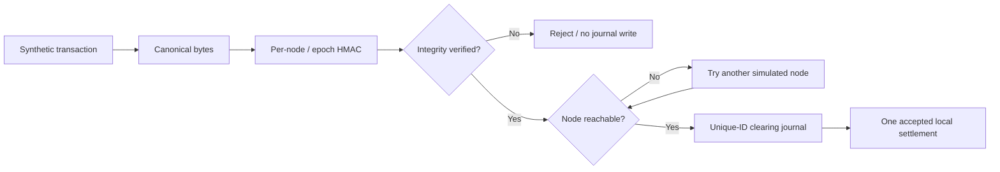

# QRCN — Quantum-Resilient Clearing Network (research miniature)

> **Distributed transaction integrity, simulated moving-target defense, and bounded failover. Not a quantum clearinghouse, bank, cryptocurrency, or payment processor.**

## Start here

This is a self-contained project in the [Renteria AI Systems Portfolio](../../START_HERE.md).
- [Interactive browser demo](../../hosted_demo/qrcn/index.html) (synthetic outcomes, no security guarantees)
- [Core Python implementation](qrcn/core.py)
- [Automated tests](tests/test_core.py)
- [Threat model and security limits](docs/THREAT_MODEL.md)
- [Evidence and outstanding gates](docs/VALIDATION.md)

## Purpose

Explore the tradeoffs among message integrity, simulated key rotation, replay rejection, a single-process clearing journal and failover. A researcher can inject a tampered payload, stale authentication tag, node outage or lost acknowledgment and observe whether the local toy ledger accepts, rejects or reroutes the transaction.

## Architecture


## Run

Requires Python 3.11+ (standard library only).

```bash
cd portfolio_projects/qrcn
python -m unittest discover -s tests -v
python -m scripts.run_demo
```

## Defined security boundary

- Key derivation is demonstrated using per-node HMAC-SHA256 tags and a monotonically increasing local key epoch. **No post-quantum algorithm or actual key distribution is implemented.**
- Integrity checks cannot provide confidentiality. The simulated payload is visible to the app and browser demo.
- The journal is an in-memory Python dictionary. This is *not* distributed exactly-once consensus, fault-tolerant persistence or double-entry accounting.
- Failover simulates selection of a second node after an outage. It is not a realistic distributed recovery guarantee.
- No real payments, financial accounts, network packets, quantum entanglement, QKD, FIPS-certified security or production API integration.
- The browser UI depicts **synthetic, predefined educational cases** rather than interacting with the Python security implementation.

## Project gates

Development: working Python logic, automated tests, reproducible scenario outputs, demonstrable intentional failures.
Independent validation: **OPEN** — requires third-party threat review and held-out perturbations.
Production: **OPEN** — requires durable transaction journal, distributed consensus/atomicity model, secure identity/key vault, authenticated network transport, PQC migration design, real operational metrics and legal/regulatory review.

## Project origin and naming

Inspired by a proposed moving-target, decentralized settlement and quantum security architecture. Earlier claims that packet mutation or entanglement instantly eliminate hacking are **not technically supported** and are deliberately excluded. A future ML-KEM/ML-DSA adaptation should use appropriate standardized libraries and independent cryptographic review rather than invent novel encryption.
